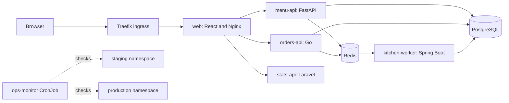

# Dhaba Orders

Dhaba Orders is a containerized restaurant ordering application built as a set of small services. Customers can browse a menu and place orders; kitchen staff can track order progress; and the stats view summarizes recent activity.

The repository includes the application, Kubernetes manifests, container build tooling, and a GitHub Actions workflow for building and deploying images to a kind cluster on an EC2 host.

## Services

| Service | Technology | Port | Responsibility |
|---|---|---:|---|
| `web` | React, Vite, Nginx | 8080 | Serves the project page and ordering UI at `/app`; proxies browser API requests to the backend services. |
| `menu-api` | Python, FastAPI | 8000 | Provides menu data from PostgreSQL and uses Redis for caching. |
| `orders-api` | Go | 8080 | Creates and reads orders, queues kitchen work, and updates order statistics. |
| `kitchen-worker` | Java, Spring Boot | — | Processes queued orders and advances them through kitchen statuses. |
| `stats-api` | PHP, Laravel | 9000 | Provides order and dish statistics using Redis data. |
| `postgres` | PostgreSQL 16 | 5432 | Stores menu and order data. |
| `redis` | Redis 7 | 6379 | Provides menu caching, the order queue, and statistics data. |
| `ops-monitor` | Alpine Linux, Bash, `kubectl` | — | Runs the cluster monitoring checks as a Kubernetes CronJob. |

## Architecture



The web application sends requests to same-origin `/api/*` routes. Nginx forwards them to Kubernetes Services, so the browser does not need direct access to internal service names. The worker consumes queued orders and updates their status. PostgreSQL and Redis run as StatefulSets with persistent volumes.

## Kubernetes environments

The deployment uses three project namespaces:

| Namespace | Contents |
|---|---|
| `staging` | Application environment deployed by CI for rollout and smoke checks. |
| `production` | Live application environment, deployed after the production approval gate. |
| `ops` | Monitoring and ECR pull-secret refresh CronJobs, their ServiceAccounts, and saved state. |

Kubernetes system namespaces such as `default` and `kube-system` are managed by the cluster and are not project environments. Staging and production use the shared Kustomize base with a small environment overlay for namespace-specific settings.

The EC2 setup uses kind, Traefik, cert-manager, and the local-path provisioner. The staging and production overlays route `visionary-rebel-staging.duckdns.org` and `visionary-rebel-production.duckdns.org` through Traefik and request TLS certificates from Let's Encrypt. Because this is a single-node cluster, the app and its local persistent volumes share the EC2 instance's failure boundary; it is intended for learning, demos, and small workloads rather than high availability.

## CI/CD

The GitHub Actions workflow in [`.github/workflows/ci.yml`](.github/workflows/ci.yml) runs service tests, linting, Dockerfile and shell checks, and Kubernetes manifest validation. On a push to `main`, it builds images for changed services, tags them with the commit SHA, pushes them to private Amazon ECR repositories, and waits for ECR image scans. Critical findings block the pipeline.

Changed application images deploy to staging through AWS Systems Manager (SSM). A successful staging rollout and smoke check precede the production job, which is gated by approval in the GitHub Actions `production` environment. The EC2 instance uses an attached IAM role to pull images and receive SSM commands. Separate, scoped deployment identities are used by the workflow; the Kubernetes pipeline ServiceAccount is limited to `staging` and `production` and has no access to `ops`.

The `ops` namespace uses separate identities. The monitoring CronJob checks workload and database readiness every minute. The ECR refresh CronJob renews namespace-local image pull secrets every six hours. Neither identity is used by the application deployment pipeline.

## Repository layout

```text
web/                    React frontend and Nginx configuration
menu-api/               FastAPI menu service
orders-api/             Go order service
kitchen-worker/         Spring Boot queue consumer
stats-api/              Laravel statistics service
postgres/               PostgreSQL image configuration
redis/                  Redis image configuration
ops-monitor/            Monitoring utility image
k8s/base/               Shared application manifests
k8s/overlays/           Staging and production Kustomize overlays
k8s/ops/                Ops workloads, RBAC, and monitoring scripts
ec2-kind-setup/         EC2 kind setup bundle and operator guide
aws/                    IAM policy templates and SSM documents
scripts/                ECR repository and image build helpers
docs/                   Image build and deployment documentation
```

## Deployment guide

See [`ec2-kind-setup/README.md`](ec2-kind-setup/README.md) for preparing the EC2 host and kind cluster. See [`docs/BUILD-AND-PUSH.md`](docs/BUILD-AND-PUSH.md) for building images, ECR setup, and GitHub Actions configuration.

Deployment requires AWS resources, a running kind cluster, ECR repositories, and GitHub Actions configuration. Use your own AWS account, region, instance ID, and DNS hostnames when following the guides. Keep credentials in GitHub Actions Secrets or an EC2 instance role; do not add credentials to the repository.

## Security

- Do not commit AWS access keys, DuckDNS tokens, private keys, database passwords, `.env` files, or populated Kubernetes Secret manifests.
- Store workflow credentials in GitHub Actions Secrets and create application secrets through the documented bootstrap process.
- Keep the ECR publisher, staging deployer, production deployer, EC2 instance role, and Kubernetes ServiceAccounts separate and narrowly scoped.
- Application pods do not need Kubernetes API access and have automatic ServiceAccount token mounting disabled. Monitoring and secret-refresh jobs use separate ServiceAccounts with namespace-scoped permissions.
- Restrict EC2 inbound access to the ports and source addresses required by the deployment. Use non-production data in this demo environment.
- Review repository history and GitHub Actions configuration before making a repository public; deleting a secret from the current README does not remove it from Git history.

## License

No `LICENSE` file is currently included. Public visibility alone does not grant permission to reuse or redistribute this project. Add a license file if you want to grant those rights.
